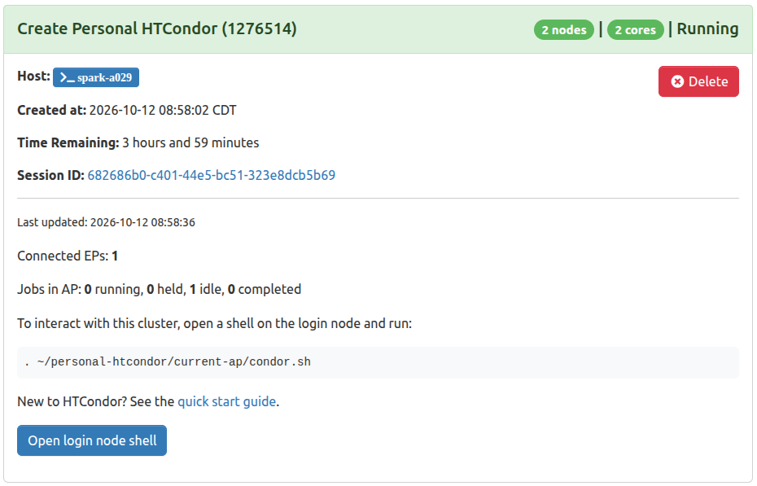
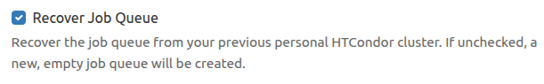

# Personal HTCondor Cluster on CHTC Open OnDemand

This repository contains instructions for launching a single-user HTCondor cluster on CHTC's [Open OnDemand instance](https://ondemand.chtc.wisc.edu/):

- Creating an HTCondor cluster consisting of a Submit Node (Acess Point) and Worker Nodes (Execution Points), as a single-node Slurm Job.
- Submitting HTCondor jobs to your cluster using Open OnDemand's interactive web terminal.

# Log into CHTC's Open OnDemand

CHTC's Open OnDemand instance can be accessed at [ondemand.chtc.wisc.edu](https://ondemand.chtc.wisc.edu/). Log in using your UW NetID and Password.

If you are new to CHTC and need help setting up an account, [apply for access](https://chtc.wisc.edu/uw-research-computing/form.html) via the CHTC user app.

If you are an existing CHTC user and are unable to access Open OnDemand, contact the CHTC [facilitation team](https://chtc.cs.wisc.edu/uw-research-computing/get-help.html) for help.

# Schedule an HTCondor Cluster on your Slurm Cluster

Your Personal HTCondor cluster runs as a single-node Slurm job. The job runs an Access Point (on 1 CPU and 2 GB of memory
added to your request), which manages your HTCondor job queue, and an Execution Point on the CPUs and memory you
requested, which runs your HTCondor jobs.

To launch an instance of the **Create Personal HTCondor Cluster** interactive app:

1. Navigate to the "Interactive Apps" section of the Open OnDemand dashboard.

   

1. Select "Create Personal HTCondor Cluster".

1. In the app's submission form, select a slurm partition and resource requests for your jobs.
    - All fields may be left as the default.

1. Check the "Create Sample Submit File" checkbox. This creates a sample executable file, 
   and a submit description file for running this executable as an HTCondor job, in
   `~/personal-htcondor/sample-submit`.

1. "Launch" the app.

1. Watch the status of your AP interactive app. Wait for the AP app to reach the "Running" state. 

   

# Submit your first HTCondor Job

The AP and EP in your interactive app comprise a complete HTCondor cluster. HTCondor jobs submitted to your AP
will run on your EPs. 

Place a "Hello World" HTCondor job into your AP's job queue.


1. Access the Spark Login Node

    Open a Shell on the Spark login node via the "CHTC Spark Cluster Shell Access" menu item in Open OnDemand.
    You will be prompted to log in again with your NetID and password.

1. Set up your HTCondor environment

    Source the following file in your home directory. This file configures the HTCondor command line tools on the
    Spark login node to run against your Personal AP:

    ```
    . ~/personal-htcondor/current-ap/condor.sh
    ```

    You may also add the above line to your `~/.bashrc` to perform this configuration on every login.

1. Change to your Sample Job's directory

    ```
    cd ~/personal-htcondor/sample-submit
    ```

1. Submit your HTCondor Job to your AP

    ```
    condor_submit hello.sub
    ```

1. Confirm that your Job Runs on the EP

    ```
    condor_watch_q
    ```

1. Check the output of your job after it finishes

    ```
    cat hello.out
    ```

1. If the job ran successfully, expect output similar to:

    ```
    Hello, World!
    I am running on hpc-worker123
    ```

# Additional Utilities

## Queue jobs before launching a cluster

Your HTCondor job queue is stored on disk and survives between sessions, so you can prepare jobs ahead of time:

1. Launch the **Create Personal HTCondor Access Point** app. It runs only an AP, with no Execution Points.
1. Submit your jobs from its login-node shell as usual. They wait in your queue.
1. Cancel the session, then launch **Create Personal HTCondor Cluster**. It picks up your saved queue automatically, and
   your jobs run without being resubmitted.

The cluster app always continues the existing job queue, and creates one only if you have never launched an AP before.
Cluster sessions exit after 4 hours by default; jobs still in your queue are picked up the next time you launch a cluster.

## Start a new job queue

To discard your existing queue and start empty, launch the **Create Personal HTCondor Access Point** app with the
"Recover Job Queue" checkbox unchecked. This checkbox only appears once you have an existing queue.



**Note:** For best results, avoid scheduling multiple simultaneous instances of the Personal HTCondor interactive apps. Ensure that your previous
instance is completed or cancelled before launching a new one.
